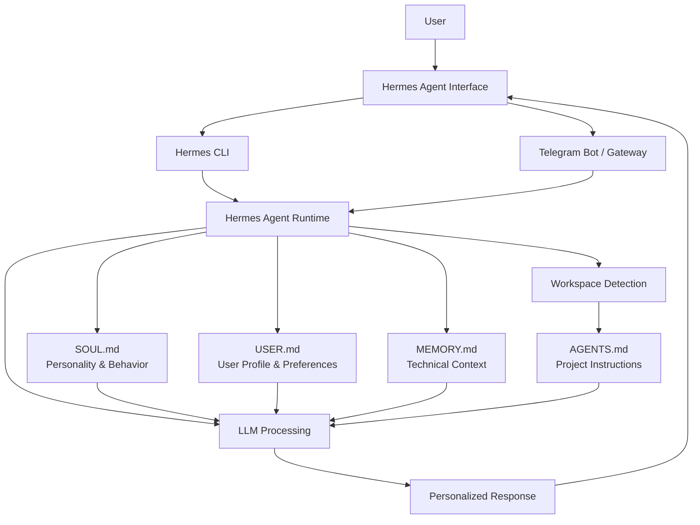

# Hermes Agent — System Architecture

## 1. Overview

The Personalized Hermes AI Assistant is configured using multiple instruction and memory files that work together to provide personalized responses, persistent technical context, dynamic expert role switching, and workspace-specific guidance.

## 2. Architecture Diagram

## 3. Configuration Components

### SOUL.md — Personality and Behavior
Defines the assistant's communication style, behavior, and role adaptation. Supports dynamic expert role switching, such as Power BI SME and GenAI Architect.

### USER.md — User Profile
Contains professional background, expertise, preferences, and preferred response style. Helps tailor responses to the user's context.

### MEMORY.md — Persistent Technical Context
Stores technical stack, active projects, development conventions, and useful long-term information.

### AGENTS.md — Workspace Instructions
Contains project-specific development guidelines, coding conventions, and security practices. It is discovered when Hermes operates within the configured workspace.

## 4. Interaction Flow

1. User sends a request through the CLI or Telegram.
2. Hermes Agent processes the request within its runtime.
3. Relevant personalization and instruction files provide context.
4. The LLM generates a response based on the request and available context.
5. Workspace-specific instructions apply when Hermes is operating within the relevant workspace.
6. The response is returned through the selected interface.

## 5. Dynamic Expert Role Switching

The assistant can adapt its response approach based on explicit role-switching instructions.

Examples:
- **Power BI SME:** DAX, semantic models, Import vs DirectQuery, optimization, and reporting architecture.
- **GenAI Architect:** RAG, embeddings, vector databases, knowledge graphs, agentic workflows, and enterprise AI architecture.

Role switching changes the response focus and expertise framing without requiring separate assistant instances.

## 6. Interfaces

- **Hermes CLI:** Interactive terminal-based access for configuration and testing.
- **Telegram Bot:** Remote conversational access through the configured Telegram integration.
- **Hermes Gateway:** Supports the connected messaging interface.

## 7. Architecture Notes

- Configuration files are maintained under `~/.hermes/`.
- Workspace instructions are maintained in the relevant project directory.
- Memory behavior depends on configured settings and available context.
- Direct file retrieval and automatic memory recall are distinct capabilities; validation should test both independently.

## 8. Conclusion

This architecture combines user personalization, persistent technical context, adaptable expert roles, and workspace-aware instructions to create a practical AI assistant for technical and professional workflows.